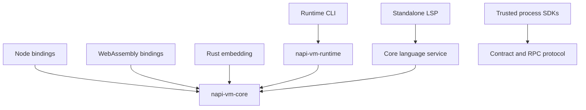

# Architecture and source map

The project separates language execution from host services. The core can run
without Node.js or the optional runtime; bindings and runtime adapters decide
how code, values, modules, and external events cross into that core.

Trusted process plugins are an independent integration. They execute in child
processes and do not evaluate their implementation in this VM.

## Follow a guest program

| Stage | Source owner | Responsibility |
| --- | --- | --- |
| Lexing | [lexer.rs](../crates/napi-vm-core/src/lexer.rs) | Tokens, source positions, and literal decoding |
| Parsing | [parser/](../crates/napi-vm-core/src/parser/) | AST construction, validation, and bounded exact-source caches |
| Preparation | [bytecode/](../crates/napi-vm-core/src/bytecode/) | Compilation, verification, constants, and execution |
| Evaluation | [interpreter/](../crates/napi-vm-core/src/interpreter/) | AST fallback, calls, environments, modules, and jobs |
| Values | [value.rs](../crates/napi-vm-core/src/value.rs), [js_string.rs](../crates/napi-vm-core/src/js_string.rs) | Guest representations, properties, buffers, and UTF-16 strings |
| Builtins | [builtins/](../crates/napi-vm-core/src/builtins/) | ECMAScript behavior, including Intl and Temporal |
| Layout caches | [shape.rs](../crates/napi-vm-core/src/shape.rs) | Shared key layouts and guarded slot lookup |
| Collection | [heap.rs](../crates/napi-vm-core/src/heap.rs) | Roots, graph tracing, and cycle reclamation |

Bytecode handles supported forms; unsupported forms retain semantic AST
fallback. Inline caches verify shapes and slot keys. Shapes describe key layout,
while writable/configurable/accessor metadata remains per object. A value-only
write can preserve a layout; additions, deletions, and descriptor changes need
the corresponding checks.

## Ownership and collection

Guest graphs use reference counting plus explicit cycle collection. Run
collection at a quiescent boundary, after releasing temporary results that must
not remain roots. Fresh-VM benchmark loops must include teardown and collection
when that is the measured lifecycle.

NAPI owner contexts lease heap, shape, symbol, and collection state around
runtime access. Ownership allows the native binding to schedule work without
making guest `Rc` graphs thread-safe. Workers send host data or completion
records back to the owner; they do not manipulate arbitrary guest values.

Rust callback captures are opaque to graph traversal. Pin captured guest values
with `heap::RootPin` for their required lifetime under the same owner context.
Do not rely on a Rust closure capture alone to keep a guest graph live during
cycle collection. Relevant ownership regressions live in [tests/](../tests/).

## Binding and service owners

| Component | Source |
| --- | --- |
| Node VM API, callback bridge, marshalling, async owner | [src/bindings/](../src/bindings/) |
| Browser `WasmVm` | [src/wasm.rs](../src/wasm.rs) |
| Pure language analysis | [core lang/](../crates/napi-vm-core/src/lang/) |
| LSP transport, positions, live metadata client | [src/lsp/](../src/lsp/) |
| Node live-metadata publisher | [runtime/session.cjs](../runtime/session.cjs) |
| Portable TypeScript VM plugin host | [plugins/](../plugins/) |
| Rust VM plugin host | [src/plugin_host/](../src/plugin_host/) |
| Optional runtime | [napi-vm-runtime](../crates/napi-vm-runtime/src/) |
| Trusted child-process packages | [packages/](../packages/) and [plugin crates](../crates/) |

The facade [src/lib.rs](../src/lib.rs) reexports the core and adds gated host
surfaces. [Cargo.toml](../Cargo.toml) is the authoritative feature wiring.
The runtime guide lists the selection rules; enabling a feature makes code
available, while builder calls and permission grants choose actual authority.

## Generated inputs

NAPI declarations/loaders come from the binding build. Contract references and
bindings come from `@napi-vm/plugin-codegen`. Rust scaffold SDKs are synchronized
copies of first-party crates. Unicode, CLDR, and timezone tables come from
[explicit data generators](../tools/generators/README.md), not normal builds.
Change the owning input or generator and regenerate; handwritten changes to
generated outputs will be lost.

Use [development](development.md) for gates and [validation](validation.md) for
the limits of recorded compatibility claims.
